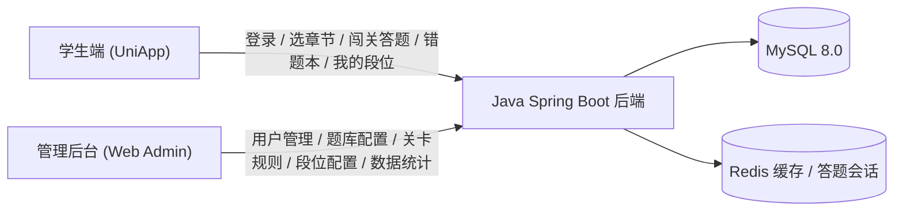

# 「过关啦」产品原型文档（全栈重构版）

> **文档版本**：v2.0（修仙体系与精简后台升级）  
> **原型基线**：`C:\Users\LangLang\Downloads\过关啦-完整源码\过关啦-完整源码`（v4 / 2026-11-06）  
> **目标形态**：UniApp 学生端（`vue-uniapp-template` + `@wot-ui/ui`） + Web 管理后台（`pure-admin-thin` 精简四页面） + Java 后端服务

> [!IMPORTANT]
> **v2.0 核心架构演进（修仙境界体系）**：
> 1. **六大修仙境界对应六档难度**：`练气`（难度一 · 基础 / 初一）→ `筑基`（难度二 · 入门 / 初二）→ `结丹`（难度三 · 提升 / 初三）→ `假婴`（难度四 · 强化 / 高一）→ `元婴`（难度五 · 高阶 / 高二）→ `化神`（难度六 · 巅峰 / 高三）。
> 2. **全境界开放与压制境界**：解除低境界不可挑战高境界的等级限制，支持学生自由选择任意境界章节学习；高境界学生仍可通过「压制境界」切换重温低境界题库。
> 3. **进阶考核随机抽题晋升**：学完本境界要求关卡（默认全部通关，后台可配解锁关数）后解锁进阶考核，由系统从本境界题库随机抽取指定数量题目，得分达到后台配置的百分制分数线即晋升至下一境界。
> 4. **极简前台与通俗后台**：学生端保留三大 Tab（`首页` / `错题本` / `我的`）；管理后台精简为【数据概览、境界与进阶设置、学生管理（支持直接改境界）、章节与题库管理】四个通俗易懂的菜单。

---

## 一、项目背景与升级目标

### 1.1 原版原型盘点

原版「过关啦 · 数学基础自测神器」是一个零依赖的纯前端单页 PWA 应用，核心亮点非常明确：
1. **清晰的学段与章节骨架**：覆盖人教版初一到高三共 **6 个年级、51 个章节**，每章固定 **4 道关卡**（基础关 → 中档关 → 拓展关 → 压轴关），总计 **204 关**。
2. **静/动结合的出题机制**：204 关中 **68 关为静态题库**（概念/定理判定，共 204 题），**136 关为随机生成器题目**（每次闯关动态生成数字与选项，防止死记硬背）。
3. **轻量化游戏激励**：每关 3 题、答对 ≥ 2 题（`Math.ceil(n * 2 / 3)`）即可点亮关卡并解锁下一关；累计过关数驱动 **10 级创意段位**（从「数学村的小学徒」到「数学世界之神」）。
4. **闭环复习机制**：答错题目自动进入「错题本」，支持一键重做与已掌握移除。

### 1.2 全栈重构核心目标

原版受限于纯前端无服务端架构，存在数据仅存本机 `localStorage`、无法账号登录同步、没有运营管理后台、教师出题依赖手动导出 JSON、正确答案直接暴露在前端 JS 中等局限。本次重构目标如下：

| 维度 | 原版 PWA 原型 | 全栈重构版目标 |
|---|---|---|
| **运行载体** | 单文件 HTML + `localStorage` | UniApp 多端（微信小程序 / H5 / App）+ Web 管理后台 + Java 服务端 |
| **用户体系** | 无登录，换设备丢记录 | 支持微信快捷登录 / 手机号或账号登录 + 游客体验模式（可同步归并） |
| **题库运维** | 修改 JS 源码或本机导入 JSON | 管理后台可视化增删改查年级、章节、关卡与题目，即时生效全端 |
| **出题安全** | 题目与答案全量打包在前端 JS | 服务端统一组卷/生成动态题，答题前不返回答案，服务端判分 |
| **教师/管理端** | 占用学生端第 4 个 Tab | 独立 Web 管理后台：查看用户信息、学习战绩，配置前台题库与关卡 |

---

## 二、用户角色与系统边界

### 2.1 角色定义

1. **学生用户（前台 UniApp）**
   - 游客态（可选开启）：允许免登录试玩第 1 章或本地体验，登录/绑定账号后云端保存与同步战绩。
   - 登录态：拥有个人档案（昵称、头像、在读年级、累计过关数、当前段位），云端持久化过关进度、答题记录与错题本。
2. **管理员 / 教研老师（Web 管理后台）**
   - 超级管理员：全部后台权限（用户管理、题库配置、关卡/段位配置、管理员账号管理、操作日志）。
   - 教研老师（可配角色）：负责查看学生学习情况、录入/编辑/导入/上下架前台题目与章节。

---

## 三、视觉与交互基调（沿用原型风格）

原版界面的配色与轻快卡片风格识别度很高，UniApp 学生端应延续并规范化为统一 Design Token：

| 视觉元素 | 色值 / 样式基准 | 说明 |
|---|---|---|
| **主题主色** | `#16a34a`（渐变 `#15803d` → `#22c55e`） | 顶部导航栏、主按钮、选中态、进度条 |
| **页面背景** | `#f0fdf4` | 清新淡绿底色，护眼不刺眼 |
| **卡片背景与边框** | `#ffffff` / 边框 `1px solid #bbf7d0` | 圆角 `24rpx~32rpx`（12~16px） |
| **主文本 / 次文本** | `#14532d` / `#1f2937` / `#6b7280` | 标题深绿、题干深灰、提示浅灰 |
| **段位 / 星级强调色** | `#f59e0b`（卡片渐变 `#fef9c3` → `#dcfce7`） | 荣誉徽章、星级、升段高亮 |
| **关卡四色分级** | 🟢 `#16a34a` / 🟡 `#d97706` / 🟠 `#ea580c` / 🔴 `#dc2626` | 对应基础关 / 中档关 / 拓展关 / 压轴关 |
| **正误反馈** | 正确 `#dcfce7` + `#22c55e`；错误 `#fee2e2` + `#ef4444` | 选项提交即时高亮 |

---

## 四、前台（UniApp 学生端）原型详细设计

### 4.1 导航架构调整说明

- **原版 4 Tab**：`章节闯关` / `错题本` / `我的过关` / `教师出题`
- **重构版 3 Tab**（将「教师出题」迁至管理后台，结构更纯粹）：
  1. `🏫 章节闯关`（首页：年级 → 章节 → 闯关地图）
  2. `📕 错题本`（错题列表、筛选、重做消灭、已掌握归档）
  3. `🎖️ 我的`（个人档案/登录状态 + 段位卡片 + 晋升之路 + 各章战绩 + 账号设置）

> 独立二级页面（隐藏底部 TabBar）：**登录页**、**闯关答题页**、**错题重做页**、**个人信息编辑页**。

---

### 4.2 页面 1：章节闯关首页（三级视图下钻）

保留原版顶部绿底大标题栏（标题「过关啦」、副标题「数学基础自测神器」、右上角动态胶囊 `🏅 X 关`），下方按三级视图流转：

#### 视图 A：选择年级（默认首屏）
1. **年级选择卡片**（3 列宫格）：
   - `初一 🌱`、`初二 🍃`、`初三 🌿`、`高一 🍃`、`高二 🌳`、`高三 🎯`（图标可在后台年级表中配置）。
   - 若用户已设置默认年级，顶部可高亮「当前在读年级」快捷入口。
2. **我的当前段位卡片**：
   - 展示当前段位图标、段位名称、励志台词、累计已过关数 `N`，以及距离下一段位的进度条与「再过 X 关晋升 XXX」。
3. **过关规则说明卡片**：
   - 说明每章 4 关逐级解锁机制、默认每关 3 题答对 2 题过关、错题自动入库规则。

#### 视图 B：章节列表
1. 顶部操作条：`← 返回年级选择` + 当前年级名称与总章节数（如 `初一 🌱 · 选择章节（10 章）`）。
2. 章节卡片（支持 2 列宫格或移动端单列清晰卡片，由 UI 选型后微调）：
   - 展示：**章节名称**（如 `第1章 有理数`）、**核心知识点副标题**（`正负数 · 数轴 · 绝对值 · 运算`）、**自定义标签**（后台新增章节可选标示）、**进度条**与星级计数（如 `★★☆☆ 已过 2/4 关`）。
   - 支持快捷筛选：全部章节 / 未通关 / 已满星。

#### 视图 C：闯关地图
1. 顶部操作条：`← 返回章节` + 章节名称与简介。
2. **4 道关卡卡片**（垂直列表）：
   - 第 1 关：`基础关`（1★，🟢）
   - 第 2 关：`中档关`（2★，🟡）
   - 第 3 关：`拓展关`（3★，🟠）
   - 第 4 关：`压轴关`（4★，🔴）
3. **关卡状态机**：
   - **已过关**：绿边浅绿底，图标 `✔`，按钮文案「再闯」，可无限次重复练习。
   - **可挑战（已解锁未过关）**：正常边框，展示题数与过关条件（如 `3 题 · 答对 2 题过关`），按钮文案「闯关」。
   - **未解锁（锁定）**：半透明置灰，图标 `🔒`，提示「先过上一关才能挑战」，不可点击进入。
   - **暂无题目**：当某后台新建关卡尚未配题时，提示「暂无题目（教研配置中）」，按钮禁用，避免空关卡报错。

---

### 4.3 页面 2：闯关答题与结算页

#### 答题态
1. **顶部进度条 + 关卡信息条**：`第1章 有理数 · 中档关（2★） 第 1/3 题`。
2. **题目卡片**：
   - 题干文本（清晰大号字，兼容数学符号 `−`、`²`、`√`、`分数` 等）。
   - 4 个互斥单选选项 `A / B / C / D`（全宽圆角卡片，点击即选中高亮）。
3. **两段式提交交互（完整保留原型优秀体验）**：
   - **阶段 1（未提交）**：选中某选项后，底部主按钮由置灰不可点变为绿色可点击「提交」。
   - **阶段 2（已锁定判题）**：点击「提交」后向后端校验本题（或整卷），前端锁定选项不可修改：
     - 正确答案高亮绿色边框/底色；若选错，用户所选项高亮红色；
     - 选项下方显示即时反馈：`✔ 答对啦！` 或 `✘ 正确答案：B. 5`；
     - 若后台配置了「题目解析」，紧随其后展示简要解题思路；
     - 按钮文案切换为「下一题」（最后一题显示「查看结算」）。
4. **防误退保护**：答题过程中点击手机/小程序返回按钮，弹窗确认「退出将不保存本次闯关进度，确定退出？」。

#### 结算态
1. 顶部结果Icon与标题：
   - 达标（`right >= passCount`，默认 `3` 题对 `2` 题）：`🎉 过关成功！`，显示答对题数与「本关已点亮」。
   - 未达标：`💪 再挑战一次`，提示答对题数与过关要求。
2. **段位晋升惊喜卡片**（仅首次通关且跨过新段位阈值时展示）：
   - 展示 `🎉⬆️ 段位晋升！` + 新段位徽章、名称与台词。
3. **错题回顾卡片**（本轮有答错题目时展示）：
   - 列出本次做错的题干、正确答案及提示「已自动收入错题本」。
4. 底部行动按钮：过关显示「解锁下一关 / 返回闯关地图」，未过关显示「再闯一次」与「返回章节」。

---

### 4.4 页面 3：错题本

1. **顶部操作与统计栏**：
   - 显示累计待攻克错题数（如 `📕 错题本（12 题）`）。
   - 筛选条（升级点）：支持按「年级」与「章节」筛选，默认显示全部未掌握错题。
   - 快捷操作按钮：`🔁 重做错题`（每次最多抽取 5 题，支持抽取当前筛选下或全局未掌握错题）与 `🗑 清空`（必须弹窗二次确认）。
2. **错题卡片列表**：
   - 展示题干、正确答案（可默认显示或点击展开解析）、来源元信息（`初一 · 第1章 有理数 · 基础关`）、出错次数与最近出错时间。
   - 单条操作：`已掌握，移出`（软标记为已掌握，不在待攻克列表展示，可支持后台或历史查看）。
3. **错题重做逻辑修正（修复原版 Bug）**：
   - 原版 `06-app.js` 误把重做中**答错**的题删掉；重构版明确约定：
     - **重做答对**：自动标记为「已掌握」并移出待消灭错题队列；
     - **重做仍答错**：保留在错题本中，错误次数 `+1`，更新最近错误时间。

---

### 4.5 页面 4：我的（个人中心 + 我的过关）

将原版「我的过关」与新引入的「用户账号体系」自然整合：
1. **用户信息头部卡**：
   - 未登录状态：显示「点击登录 / 微信一键登录」，提示「登录后云端同步过关记录与错题本」；
   - 已登录状态：头像、昵称、在读年级标签（可点击切换）、注册天数/绑定状态，右上角「编辑资料 / 设置」。
2. **当前段位卡片**：与首页共享组件，展示当前段位与晋升进度条。
3. **🎖️ 段位晋升之路**（完整沿用原版 10 级体系）：

| 序号 | 累计过关门槛 | 图标 | 段位名称 | 激励台词 |
|---|---|---|---|---|
| 1 | 0 关 | 🌱 | 数学村的小学徒 | 刚踏进数学世界，一切都很新鲜！ |
| 2 | 5 关 | 🍃 | 青青草原探险家 | 走出新手村，开始探索啦！ |
| 3 | 12 关 | ⚔️ | 持剑的基础骑士 | 基础关拿下了不少，装备升级！ |
| 4 | 24 关 | 🛡️ | 中档关勇士 | 中档题挡不住你了！ |
| 5 | 40 关 | 🏹 | 拓展森林猎手 | 拓展关的猛兽纷纷落网！ |
| 6 | 60 关 | 🐉 | 压轴巨龙挑战者 | 敢挑战压轴巨龙的勇者！ |
| 7 | 84 关 | 🧙 | 数学魔法师 | 难题在你面前都会露出解法！ |
| 8 | 120 关 | 👑 | 过关王国守护者 | 王国因你而安心！ |
| 9 | 160 关 | 💫 | 数学传说勇者 | 你的名字已被写进传说！ |
| 10 | 200 关 | 🌟 | 数学世界之神 | 通关封神！你就是数学世界之神！ |

4. **📚 各章战绩明细**：
   - 按年级分组列出已有过关记录的章节，展示 `★★☆☆` 星数与进度条，点击可直接跳转该章闯关地图。
5. **设置与退出**：退出登录、游客记录合并提示、清除本地缓存、版本号展示。

---

## 五、后台（Web 管理端）原型详细设计

管理后台面向运营与教研老师使用，重点满足**查看用户信息**与**配置前台题目、章节、关卡**两大核心诉求。

### 5.1 后台页面菜单结构

1. **登录页**：管理员账号密码登录 + 验证码/限流保护。
2. **数据总览（Dashboard）**：
   - 核心指标卡：总注册学生数、今日活跃用户数、累计闯关人次、题库总题量（静态题 / 动态模板）。
   - 图表区：近 7/30 日新增与答题趋势图、各年级通关分布柱状图、高频错题章节 Top 10。
3. **用户管理（看用户信息）**：
   - **用户列表页**：
     - 筛选项：昵称/账号模糊搜索、手机号、在读年级、当前段位区间、账号状态（正常/禁用）、注册时间范围。
     - 列表字段：用户 ID、头像昵称、手机号/OpenID 脱敏标识、在读年级、当前段位、已过关数（`/204`）、错题数、最近活跃时间、状态、操作。
   - **用户详情抽屉/页**：
     - 基本资料（支持修改在读年级/昵称或禁用/启用账号）；
     - 闯关战绩看板（按初一~高三展开各章 4 关的通关星数与首次通关时间）；
     - 答题历史流水（每次挑战某章某关的作答得分、耗时、是否过关）；
     - 错题明细查看（该用户当前未掌握的错题列表）。
4. **题库与前台配置（配置前台题目等操作）**：
   - **年级与章节管理**：
     - 树形或双栏联动：左侧选择年级（初一~高三），右侧管理下属章节；
     - 支持新增章节、修改章节名/副标题/排序、开启/隐藏（隐藏后前台学生端不可见）。
   - **关卡配置**：
     - 查看/编辑指定章节的 4 道关卡（基础关 1★ ~ 压轴关 4★）；
     - 配置每关的：名称、默认抽题数量（默认 `3`）、过关需答对题数（默认 `2`）、启用状态、可关联题目列表。
   - **题目管理（核心）**：
     - 筛选栏：年级、章节、关卡、题型（静态选择题 / 动态随机模板）、状态（上架 / 下架）、关键词搜索。
     - **静态题录入/编辑弹窗**：所属章节与关卡、题干、选项 A/B/C/D、正确答案单选、题目解析（可选）、排序权重、上架状态；内置**右侧手机端实时预览卡**。
     - **动态模板题管理**：查看系统预置的 136 个动态题型模板（支持查看参数规则、点击「试生成 3 次」即时预览效果、启停控制），并支持通过可视化 JSON 参数模板配置新的四则/方程类随机出题模板。
     - **批量导入 / 导出**：
       - 支持兼容原版前端的 JSON 文件导入（方便无缝导入原版 51 章及原教师导出数据）；
       - 支持标准 Excel 模板下载与批量上传，上传时先校验格式与缺失项，预览无误后入库。
5. **段位与系统设置**：
   - 段位管理：配置 10 级段位阈值、Emoji/图标、段位名、台词；
   - 系统配置：是否允许游客模式体验、默认过关比例、前台公告/版本说明。
6. **系统安全与日志**：
   - 管理员列表（角色分配：超级管理员 / 教研员）；
   - 操作审计日志（记录后台增删改题目、禁用用户、修改配置的操作人、IP、时间与变更摘要）。

---

## 六、原版 51 章题库全量映射清单（迁移基线）

原版题库共 **51 章、204 关**，其中 **静态关 (`qs`) 68 个（共 204 题）、动态随机关 (`gen`) 136 个（含 409 条 `mkg()` 生成表达式）**。迁移至数据库时应保留以下原始编码作为 `chapter_code`：

| 年级代码 | 年级名称 | 章节数量 | 章节编码范围 | 章节列表 |
|---|---|---|---|---|
| `g7` | 初一 | 10 章 | `c1` ~ `c10` | c1 有理数、c2 整式的加减、c3 一元一次方程、c4 几何图形初步、c5 相交线与平行线、c6 实数、c7 平面直角坐标系、c8 二元一次方程组、c9 不等式与不等式组、c10 数据的收集整理与描述 |
| `g8` | 初二 | 10 章 | `c11` ~ `c20` | c11 三角形、c12 全等三角形、c13 轴对称、c14 整式的乘法与因式分解、c15 分式、c16 二次根式、c17 勾股定理、c18 平行四边形、c19 一次函数、c20 数据的分析 |
| `g9` | 初三 | 9 章 | `c21` ~ `c29` | c21 一元二次方程、c22 二次函数、c23 旋转、c24 圆、c25 概率初步、c26 反比例函数、c27 相似、c28 锐角三角函数、c29 投影与视图 |
| `h1` | 高一 | 10 章 | `c30` ~ `c39` | c30 集合与常用逻辑用语、c31 一元二次函数方程和不等式、c32 函数的概念与性质、c33 指数函数与对数函数、c34 三角函数、c35 平面向量、c36 复数、c37 立体几何初步、c38 统计、c39 概率 |
| `h2` | 高二 | 8 章 | `c40` ~ `c47` | c40 空间向量与立体几何、c41 直线和圆的方程、c42 圆锥曲线的方程、c43 数列、c44 一元函数的导数及其应用、c45 计数原理、c46 随机变量及其分布、c47 成对数据的统计分析 |
| `h3` | 高三 | 4 章 | `c48` ~ `c51` | c48 专题1 函数与导数综合、c49 专题2 解析几何综合、c50 专题3 概率统计综合、c51 专题4 解三角形与数列综合 |

关卡分布统计（经原型源码核验）：
- `基础关`（1★）：静态 13 关 + 动态 38 关 = 51 关
- `中档关`（2★）：静态 11 关 + 动态 40 关 = 51 关
- `拓展关`（3★）：静态 17 关 + 动态 34 关 = 51 关
- `压轴关`（4★）：静态 27 关 + 动态 24 关 = 51 关

---

## 七、非功能性需求与待决策项

1. **数学公式显示**：第一阶段沿用原版清晰的 Unicode 排版（如 `−`、`²`、`√`、`∈`、`∪`），确保小程序/H5/App 零兼容问题；后续如需支持复杂分式/微积分 LaTeX，再评估轻量级富文本渲染方案。
2. **动态题目可重复性**：每次开始闯关时由后端现场生成题目并写入答题会话表，保证用户断网重连刷新当前页不会题目突变，同时确保再次挑战时重新出新题。
3. **待用户确认项**：
   - 学生端 UniApp UI 组件库选型（见 `docs/04-UI框架选型对比.md`）；
   - 学生端登录方式优先级（初期是否同时开放「账号密码 + 微信小程序一键登录 + 游客试玩」）。
